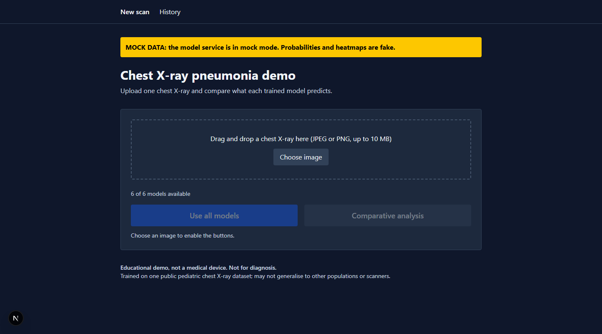
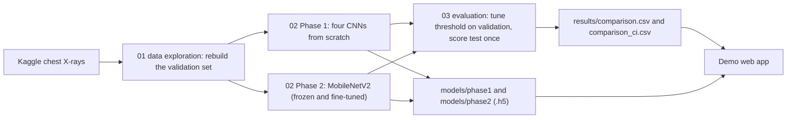
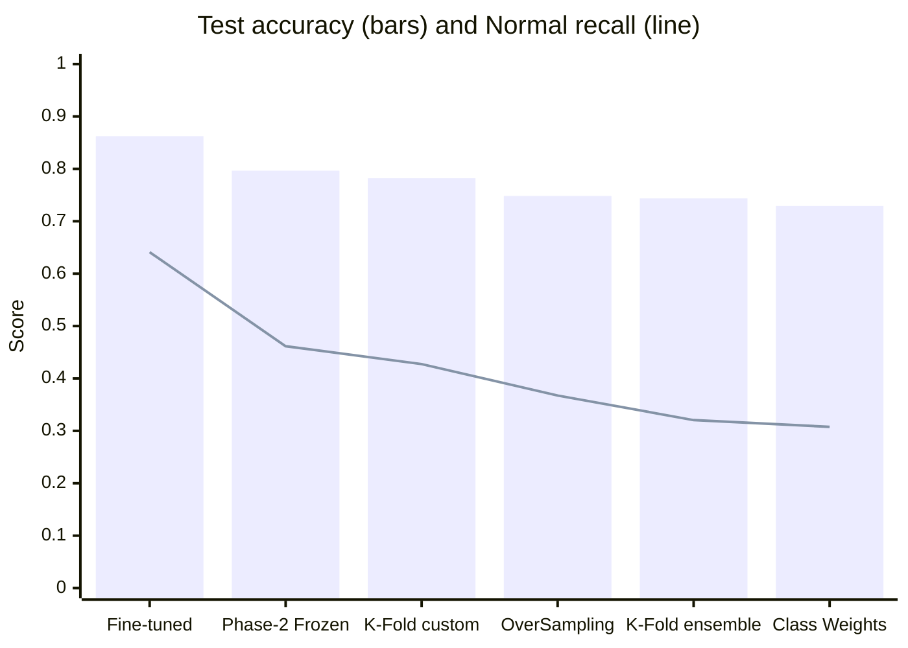
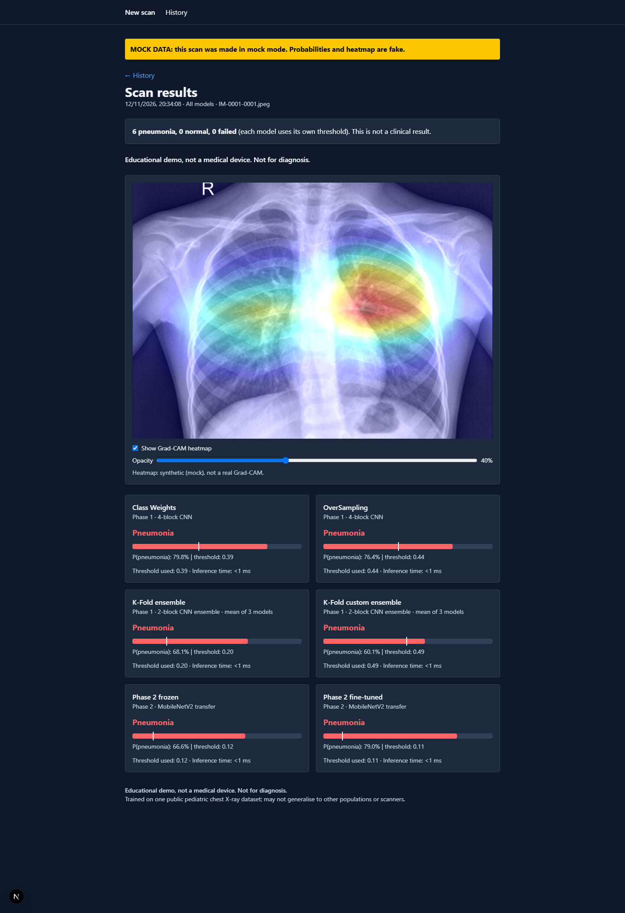
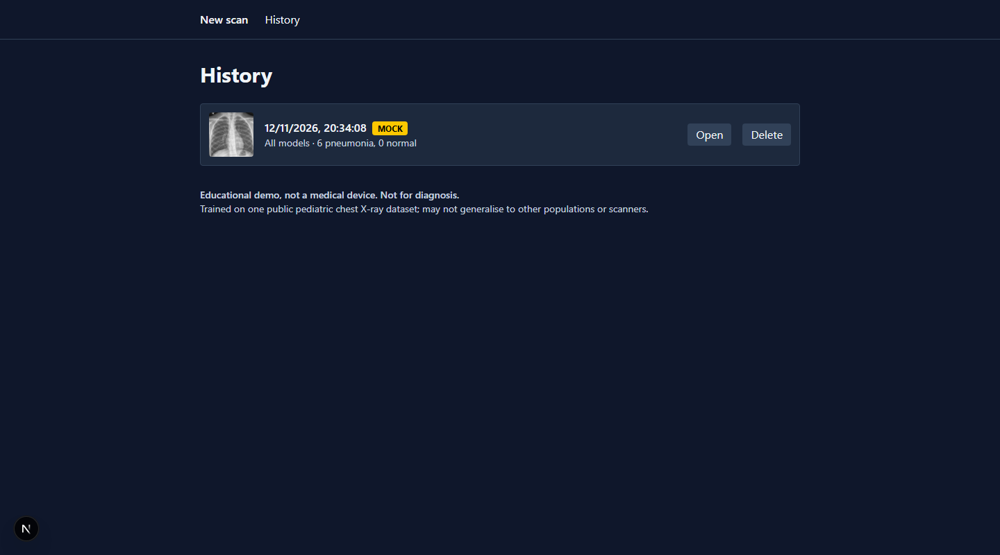
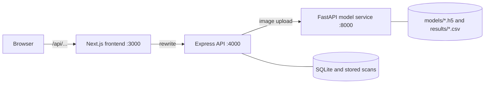

# Chest X-ray Pneumonia Detection


I trained six models to classify chest X-rays as NORMAL or PNEUMONIA, evaluated them honestly on a held-out test set, and served them in a small local web app.



*Website preview in mock mode; displayed predictions and heatmaps are simulated.*

**Jump to:** [TL;DR](#tldr) · [What and why](#what-and-why) · [Key findings](#key-findings) · [Struggles and lessons](#struggles-and-lessons) · [Results](#results) · [Demo web app](#demo-web-app) · [Limitations](#limitations) · [Reproduce it](#reproduce-it) · [Disclaimer](#disclaimer)

---

## TL;DR

- **Best model:** a fine-tuned MobileNetV2 reaches **0.8622 test accuracy** (95% CI 0.8365–0.8878) and **0.9949 Pneumonia recall**: it missed 2 of 390 pneumonia X-rays.
- **Honest weak spot:** every model over-calls pneumonia. **Normal recall is only 0.3077–0.6410** across the six models, so many healthy X-rays get flagged.
- **Method:** each model's decision threshold is tuned on the validation set only; the test set is scored once at that fixed threshold. All numbers here come from [`results/comparison.csv`](results/comparison.csv) and [`results/comparison_ci.csv`](results/comparison_ci.csv).
- **Web app:** upload an X-ray and compare all six models side by side, with Grad-CAM for the best one. See [Demo web app](#demo-web-app).

---

## What and why

This project classifies pediatric chest X-rays from the public Kaggle dataset as NORMAL or PNEUMONIA. Phase 1 is four CNN set-ups trained from scratch, each with a different way of handling class imbalance (two of them are three-model ensembles). Phase 2 is a pretrained MobileNetV2, first with a frozen backbone and then fine-tuned.

Why I built it this way:

- **Accuracy misleads on imbalanced data.** The training set is about 1 Normal to 3 Pneumonia, so a model that always says "pneumonia" already looks decent. I report Normal and Pneumonia recall separately, plus macro F1 and ROC-AUC.
- **Honest evaluation matters more than a high number.** Thresholds are tuned on validation only, the test set is used once, and every metric has a bootstrap confidence interval.
- **Missing pneumonia is the costly error.** A missed case is worse than a false alarm, so thresholds are tuned for Pneumonia F1. The flip side is the low Normal recall above, and I report it instead of hiding it.
- **Serving a model is harder than training it.** The web app has to reproduce the evaluation preprocessing exactly, per model, or the tuned thresholds stop meaning anything.



---

## Key findings

Every number below is copied from `results/comparison.csv` / `results/comparison_ci.csv` or computed from them (the arithmetic is shown).

**1. Fine-tuning a pretrained model beat every scratch CNN, and the gap is larger than the uncertainty.**
Phase 2 fine-tuned has the highest test accuracy (0.8622), Normal recall (0.6410), macro F1 (0.8387) and ROC-AUC (0.9768) of the six models. Its accuracy 95% CI (0.8365–0.8878) does not overlap with any other model's; the closest is Phase 2 frozen (0.7644–0.8270), whose upper bound is 0.0095 below the fine-tuned lower bound. Against the best Phase 1 model (K-Fold custom ensemble, 0.7821) the accuracy gain is 0.8622 − 0.7821 = 0.0801.

**2. The best model almost never misses pneumonia, but raises many false alarms.**
Rebuilding its confusion matrix from recall × class size on the test set (234 Normal, 390 Pneumonia):

| | Predicted NORMAL | Predicted PNEUMONIA |
|---|:---:|:---:|
| **Actually NORMAL** (234) | 150 = 234 × 0.6410 | 84 |
| **Actually PNEUMONIA** (390) | 2 | 388 = 390 × 0.9949 |

Cross-check: (150 + 388) / 624 = 0.8622, which is exactly the reported accuracy. The same matrix also reproduces the reported precisions: 150 / (150 + 2) = 0.9868 for Normal and 388 / (388 + 84) = 0.8220 for Pneumonia.

**3. Every model over-calls pneumonia.**
Pneumonia recall is 0.9769–0.9974 for all six models, while Normal recall is only 0.3077–0.6410. The thresholds are tuned on validation Pneumonia F1, and the validation and test distributions differ.

**4. Validation scores were optimistic for every model.**
Validation macro F1 is higher than test macro F1 for all six models, by 0.1187 (Phase 2 fine-tuned: 0.9574 − 0.8387) up to 0.2708 (K-Fold ensemble: 0.9274 − 0.6566). This is why I only trust the test numbers.

**5. Ranking quality is good even where the chosen threshold is not.**
ROC-AUC, which does not depend on a threshold, is 0.8900–0.9768. The K-Fold ensemble, for example, ranks images well (ROC-AUC 0.9431) but at its validation-tuned threshold of 0.20 it has a Normal recall of only 0.3205.

---

## Struggles and lessons

These are the problems I actually hit, roughly in the order they changed the project. The ML side was familiar to me; the frontend was new, so some entries are about learning that side. Each one points to where the evidence lives in this repository.

<details>
<summary><b>The Kaggle validation set had only 16 images</b></summary>

- **Problem:** while exploring the data in `notebooks/01_data_exploration.ipynb` I printed the split sizes and saw that the original `val/` folder had 8 Normal and 8 Pneumonia images. EarlyStopping and ReduceLROnPlateau would have been reacting to 16 images, which is mostly noise.
- **What I did:** before any training, I moved a stratified 10% of the training set into `val/` (135 Normal, 388 Pneumonia), giving 539 validation images (143 Normal, 396 Pneumonia). [One line, your words: why 10%, why stratified.]
- **Lesson:** print the size of every split before trusting any callback, checkpoint or threshold that depends on it.

</details>

<details>
<summary><b>My threshold landed exactly on the edge of my search grid</b></summary>

- **Problem:** I first searched thresholds between 0.20 and 0.80. The Phase 2 notebook printed `Val-tuned threshold: 0.20`, exactly the lower bound. A best value sitting on the edge means the search was cut off, so the real optimum could be lower.
- **What I did:** widened the grid in `03_evaluation.ipynb` to 0.05–0.95 (step 0.01) and re-ran it. The thresholds moved to 0.12 (frozen) and 0.11 (fine-tuned), both below my old floor. The web app reads the same grid (`webapp/model-service/app/benchmarks.py`).
- **Lesson:** if a tuned value lands on the edge of its range, suspect the range before the model.

</details>

<details>
<summary><b>`rescale=1/255` was silently ignored in my K-Fold generator</b></summary>

- **Problem:** in `02_model_training_k_fold_custom.ipynb` I found that `rescale=1/255` on the training `ImageDataGenerator` did nothing, because my custom generator calls `random_transform()`, which only applies the geometric augmentations.
- **What I did:** rescaled manually (`img / 255.0`) inside the generator, and documented it in a markdown cell along with an execution-order warning for the augmented-file cleanup cell.
- **Lesson:** check what preprocessing actually runs, not what the config says.

</details>

<details>
<summary><b>The served model had to match the evaluation preprocessing exactly</b></summary>

- **Problem:** Phase 1 and Phase 2 models need different inputs (grayscale with `/255` versus RGB with rescaling inside the model). Also, the Phase 1 K-Fold models were trained with OpenCV bilinear resizing but evaluated through `flow_from_directory`, which resizes with nearest-neighbour by default. My thresholds were tuned on the evaluation pipeline, so serving with different preprocessing would quietly invalidate them.
- **What I did:** the model service stores colour mode, interpolation and rescaling per model (`webapp/model-service/app/registry.py`) and follows `03_evaluation.ipynb`. I wrote `webapp/model-service/tests/test_preprocessing_tf.py` to check that the served input is bit-for-bit equal to the evaluation generator's output for both paths.
- **Lesson:** a model is its weights plus its preprocessing, so test them together.

</details>

<details>
<summary><b>Four ways of rebalancing training did not fix Normal recall</b></summary>

- **Problem:** I expected that fixing the class balance during training would fix Normal recall. I tried class weights (hand-tuned down from the sklearn defaults to `{Normal: 1.6, Pneumonia: 0.8}`, in `02_model_training_class_weights.ipynb`), disk-level oversampling (my first attempt was committed as "Trying Optimizing OverSampling (Status-Fail)"), and two balanced-batch K-Fold ensembles. All four Phase 1 models still ended with Normal recall between 0.3077 and 0.4274.
- **What I did:** kept all four as an honest comparison and moved to transfer learning (Phase 2), which reached 0.6410.
- **Lesson:** rebalancing the training data did not give balanced test performance. [Your own read on why, in one sentence.] I now report each class separately.

</details>

<details>
<summary><b>As a frontend beginner, I didn't know the proxy had its own limits</b></summary>

- **Problem:** the first prediction is slow because it loads the `.h5` models from disk. My API waits up to 120 s for the model service, but Next.js's proxy gives up after 30 s by default. It also silently cuts proxied request bodies at 10 MiB, and a truncated upload made my API return a 500.
- **What I did:** raised `proxyTimeout` and `proxyClientMaxBodySize` in `webapp/frontend/next.config.ts` (with comments on why), mapped the truncated-upload error to a 400 (`webapp/api/src/errors.ts`, tested in `webapp/api/test/scans.test.ts`), added a `cold_start` flag per model, and made the UI say that the first run can take a while.
- **Lesson:** time the cold path, not just the warm one, and look up the defaults of every layer between the browser and the model.

</details>

<details>
<summary><b>My first frontend grew bigger than I could explain, so I cut it back</b></summary>

- **Problem:** I'm new to frontend, and the first version grew more complex than I could explain file by file, which is the bar I set for this project in `CLAUDE.md`.
- **What I did:** rebuilt it smaller (commit "Stage 1-3b: model service (mock), Express API, simplified frontend") under rules I wrote down in `CLAUDE.md`: at most about 8 components, plain `fetch`/`useState`/`useEffect`, no animation or UI libraries, and a comment at the top of every file. The value of this project is the model pipeline, not the UI.
- **Lesson:** in a portfolio project, code I can explain line by line beats code that looks impressive.

</details>

## Results

All six models are evaluated by `notebooks/03_evaluation.ipynb` on the same test set (234 Normal, 390 Pneumonia). Each threshold is tuned on the 539-image validation set by searching 0.05 to 0.95 (step 0.01) for the best Pneumonia F1, then the test set is scored once at that threshold. Sorted by test accuracy:

| Model | Threshold | Accuracy | Normal recall | Pneumonia recall | Macro F1 | ROC-AUC |
|---|:---:|:---:|:---:|:---:|:---:|:---:|
| **Phase 2 fine-tuned** | **0.11** | **0.8622** | **0.6410** | **0.9949** | **0.8387** | **0.9768** |
| Phase 2 frozen | 0.12 | 0.7965 | 0.4615 | 0.9974 | 0.7447 | 0.9644 |
| K-Fold custom ensemble | 0.49 | 0.7821 | 0.4274 | 0.9949 | 0.7231 | 0.9412 |
| OverSampling | 0.44 | 0.7484 | 0.3675 | 0.9769 | 0.6760 | 0.8900 |
| K-Fold ensemble | 0.20 | 0.7436 | 0.3205 | 0.9974 | 0.6566 | 0.9431 |
| Class Weights | 0.39 | 0.7292 | 0.3077 | 0.9821 | 0.6397 | 0.8957 |

Bars show test accuracy, the line shows Normal recall (same order as the table):



95% bootstrap confidence intervals for accuracy, both recalls and ROC-AUC are in [`results/comparison_ci.csv`](results/comparison_ci.csv). Confusion matrices, ROC and PR curves and Grad-CAM examples are in [`results/figures/`](results/figures/).

---

## Demo web app

| Scan results and heatmap viewer | Saved scan history |
|---|---|
| [](docs/images/results.png) | [](docs/images/history.png) |

*Screenshots show the actual website in mock mode, using a sample from the public dataset. Predictions and heatmaps shown are simulated; they are separate from the measured model results above. Click either image to view it at full size.*

A small local web app (`webapp/`): upload one chest X-ray and every available model predicts on it. Each model shows its probability of pneumonia, its own validation-tuned threshold, its label and its inference time; the Phase 2 fine-tuned model also shows a Grad-CAM heatmap over the image. A "Comparative analysis" mode lets you pick models and adds their benchmark numbers from the CSVs. Past scans are saved and listed on a History page. A mock mode returns clearly labelled fake predictions so the website can be developed without TensorFlow.



The browser only ever talks to the Next.js server; it never calls the model service directly.

<details>
<summary><b>What is tested</b></summary>

| Part | Test files | Tests |
|---|---|---|
| Model service (pytest) | `test_health.py` (4), `test_models.py` (14), `test_predict.py` (24), `test_registry_contract.py` (13) | 55 in mock mode, no TensorFlow needed |
| Model service, real models (pytest, `-m tf`) | `test_preprocessing_tf.py` (3) | served input equals the evaluation generator for both preprocessing paths; Grad-CAM on the fine-tuned model |
| API (vitest) | `db.test.ts` (8), `scans.test.ts` (28), `service.test.ts` (7) | 43 test definitions, 80 test cases once parametrised tables expand |
| Frontend (vitest) | `errors.test.ts` (3), `format.test.ts` (4) | 7 |

Highlights: the model registry is checked against the registry and generator cells of `03_evaluation.ipynb`; the API is tested against a fake model service for uploads, validation errors, service down or timing out, history paging, path-traversal attempts, and that deleting a scan removes both its database rows and its files.

</details>

Setup and run commands (mock mode and real mode): [`webapp/README.md`](webapp/README.md).

---

## Limitations

- **One dataset.** All models were trained on one public pediatric chest X-ray dataset. They may not generalise to adults, other hospitals, other scanners or other image formats.
- **Not a medical device.** This is an educational project. It must not be used for diagnosis.
- **Low Normal recall.** Every model over-calls pneumonia (Normal recall 0.3077–0.6410), so many healthy X-rays would be flagged.
- **Thresholds come from the validation set only.** That is deliberate, but validation was optimistic for every model (see [Key findings](#key-findings)).
- **Phase 1 resize mismatch.** The Phase 1 K-Fold models were trained with OpenCV bilinear resizing but are evaluated and served with nearest-neighbour resizing, to match the pipeline the thresholds were tuned on.
- **Grad-CAM only for Phase 2 fine-tuned.** A heatmap shows where the model looked, not whether it was right.
- **Untested hypothesis:** the validation set is 26.5% Normal (143 / 539) while the test set is 37.5% Normal (234 / 624). This difference in class mix *might* contribute to the low Normal recall at the validation-tuned thresholds; I have not tested it.

**Ideas, not promises:** test the class-mix hypothesis above; try a threshold objective that weighs Normal recall too; evaluate on a second, independent X-ray dataset.

---

## Reproduce it

1. Download the [Kaggle Chest X-Ray Images (Pneumonia)](https://www.kaggle.com/datasets/paultimothymooney/chest-xray-pneumonia) dataset into `data/train/`, `data/val/` and `data/test/` (each with `NORMAL/` and `PNEUMONIA/`).
2. Create a Python 3.10 environment and install [`requirements.txt`](requirements.txt).
3. Run the notebooks in order: `01_data_exploration.ipynb` (it **moves** images from `train/` to `val/`, so run it once), the five `02_model_training_*.ipynb` notebooks, then `03_evaluation.ipynb`. Models are saved to `models/phase1/` and `models/phase2/`; results to `results/`.
4. For the web app, follow [`webapp/README.md`](webapp/README.md).

<details>
<summary><b>Class distribution (after rebuilding the validation set)</b></summary>

| Split | NORMAL | PNEUMONIA | Total |
|---|---:|---:|---:|
| Train | 1,206 | 3,487 | 4,693 |
| Val | 143 | 396 | 539 |
| Test | 234 | 390 | 624 |

The original Kaggle split had 1,341 / 3,875 in train and 8 / 8 in val; 135 Normal and 388 Pneumonia images were moved from train to val (`01_data_exploration.ipynb`).

</details>

<details>
<summary><b>Phase 1: architectures and imbalance strategies</b></summary>

**Strategies 1 and 2 (Class Weights, OverSampling)** use a 4-block CNN with Global Average Pooling (used instead of Flatten to reduce parameters and overfitting):

```
Input (224×224×1 grayscale)
  → Conv2D(32)  + BN + ReLU + MaxPool + Dropout(0.1)
  → Conv2D(64)  + BN + ReLU + MaxPool + Dropout(0.2)
  → Conv2D(128) + BN + ReLU + MaxPool + Dropout(0.2)
  → Conv2D(256) + BN + ReLU + MaxPool + Dropout(0.3)
  → GlobalAveragePooling2D
  → Dense(256, relu) + Dropout(0.4)
  → Dense(128, relu) + Dropout(0.3)
  → Dense(1, sigmoid)
```

**Strategies 3 and 4 (K-Fold ensembles)** use a lighter 2-block CNN, three models per strategy:

```
Input (224×224×1 grayscale)
  → Conv2D(32) + BN + ReLU + MaxPool + Dropout(0.1)
  → Conv2D(64) + BN + ReLU + MaxPool + Dropout(0.2)
  → Flatten
  → Dense(128, relu) + Dropout(0.3)
  → Dense(1, sigmoid)
```

Shared: Adam (lr 0.0001), binary cross-entropy, EarlyStopping + ReduceLROnPlateau + ModelCheckpoint.

- **Class Weights:** class weights `{Normal: 1.6, Pneumonia: 0.8}`, hand-tuned down from the sklearn balanced defaults (about 1.95 / 0.67).
- **OverSampling:** augmented copies of Normal images written to disk until Normal matched Pneumonia (1,206 → 3,487), then deleted after training.
- **K-Fold ensemble:** a generator that samples exactly half Normal and half Pneumonia in every batch (with replacement), three folds from `sklearn.StratifiedKFold`; the prediction is the mean of the three models.
- **K-Fold custom ensemble:** the same, but with a hand-written stratified K-Fold split instead of sklearn's.

</details>

<details>
<summary><b>Phase 2: MobileNetV2 architecture and training</b></summary>

From `notebooks/02_model_training_phase2_transfer.ipynb`:

```
Input (224×224×3 RGB, raw 0–255 pixels)
  → Rescaling(1/127.5, offset=-1)      # MobileNetV2 preprocessing, inside the model
  → MobileNetV2 (ImageNet weights, no top)
  → GlobalAveragePooling2D
  → Dense(256, relu) + Dropout(0.4)
  → Dense(1, sigmoid)
```

- **Input:** X-rays are loaded as 3-channel RGB with bilinear resizing so the ImageNet weights can be used as they are.
- **Training data:** a balanced per-batch generator (equal Normal and Pneumonia per batch, sampled with replacement) with online augmentation: rotation, zoom, width/height shift, shear and horizontal flip.
- **Stage 1, frozen backbone:** only the new head is trained (Adam, lr 1e-3). Saved as **Phase 2 frozen**.
- **Stage 2, fine-tuning:** the last 30 layers of MobileNetV2 are unfrozen while BatchNormalization layers stay frozen (19 trainable backbone layers), trained with Adam at lr 1e-5. Saved as **Phase 2 fine-tuned**.
- Both stages: up to 15 epochs with EarlyStopping, ReduceLROnPlateau and ModelCheckpoint on `val_loss`, plus a save/load round-trip check.
- **Grad-CAM** is computed on the last MobileNetV2 feature map to show which regions drive the pneumonia prediction.

</details>

<details>
<summary><b>Repository layout</b></summary>

```
Chest-Xray-Pneumonia-Detection/
├── data/                       # Kaggle images: train/, val/, test/ (not in git)
├── notebooks/
│   ├── 01_data_exploration.ipynb
│   ├── 02_model_training_class_weights.ipynb
│   ├── 02_model_training_OverSample.ipynb
│   ├── 02_model_training_k_fold.ipynb
│   ├── 02_model_training_k_fold_custom.ipynb
│   ├── 02_model_training_phase2_transfer.ipynb
│   └── 03_evaluation.ipynb
├── models/                     # phase1/ and phase2/ .h5 files (not in git)
├── results/
│   ├── comparison.csv          # test metrics + validation-tuned threshold per model
│   ├── comparison_ci.csv       # bootstrap 95% confidence intervals
│   ├── figures/                # confusion matrices, ROC/PR curves, Grad-CAM examples
│   └── predictions/            # cached model predictions (.npy)
├── webapp/                     # demo web app, see webapp/README.md
│   ├── frontend/               # Next.js website
│   ├── api/                    # Express API + SQLite
│   └── model-service/          # FastAPI model server
├── requirements.txt
└── README.md
```

</details>

---

## Disclaimer

This project is strictly for educational and research purposes. It is not a medical device and must not be used for real-world medical diagnosis.


## What needs to be done

Review date: 12 November 2026. Unchecked items are proposed work, not completed changes.

Portfolio priority: finish first. Keep the current architecture and existing trained models.

- [ ] Extract the upload-to-save workflow in `webapp/api/src/routes/scans.ts` into one named service function; keep request validation and HTTP responses easy to follow.
- [ ] Preserve preprocessing contracts, mock/real separation, upload validation, error handling and existing tests during any refactor.
- [ ] Shorten this README by moving detailed experiment lessons into `docs/`; keep the demo, architecture, results and limitations prominent.
- [ ] Document a portable inference setup using existing model artifacts, separate from training instructions.
- [ ] After changes, run the relevant existing checks and verify one real-model upload, prediction, heatmap and history flow; record the actual outcome.
- [ ] Add a short demo recording or screenshots and prepare explanations of preprocessing parity, storage failures and cold starts.

No retraining is required for this finishing scope.
